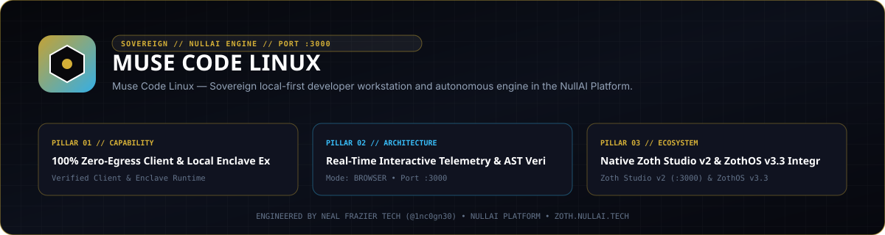
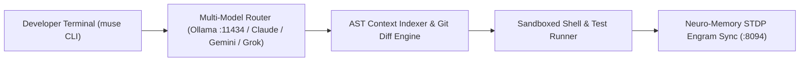

<div align="center">
  
</div>

<br />

<div align="center">
  <a href="https://zoth.nullai.tech/tools/muse-code-linux"></a>
  <a href="https://zothos.nullai.tech"></a>
  <a href="https://nullai.tech"></a>
</div>

# ⚡ Muse Code Linux (`muse-code-linux`)

> **Sovereign multi-model coding agent shell, AST diff patcher, and terminal pair-programmer engineered for ZothOS v3.4 and Linux workstations.**

---

## 🏛️ Architectural Overview



| Property | Specification |
| :--- | :--- |
| **Tool ID** | `muse-code-linux` |
| **CLI Binary** | `/usr/local/bin/muse` |
| **Category** | `Sovereign AI & Coding Agents` |
| **Local Loopback** | `http://127.0.0.1:11434` (Ollama) + `http://127.0.0.1:3000/tools/muse-code-linux` |
| **Zoth Studio Route** | [`https://zoth.nullai.tech/tools/muse-code-linux`](https://zoth.nullai.tech/tools/muse-code-linux) |

---

## 💎 Key Capabilities

- **Local-First & Multi-Provider Model Routing**: Seamlessly switches between local Ollama models (`qwen2.5-coder`, `deepseek-r1`, `hermes3`) on `127.0.0.1:11434` and frontier APIs when configured.
- **Deterministic Git & AST Diff Patching**: Previews unified diffs with syntax highlighting before applying file edits, with instant 1-command git rollback.
- **Integrated Test & Lint Verification Loop**: Automatically executes unit test suites and linters after applying patches.
- **Zero-Egress Sovereign Guarantee**: Operates 100% offline with local weights and zero telemetry leakage.

---

## 🚀 Quick Start & CLI Usage

```bash
# Launch interactive Muse coding session in current git repo
muse

# Check Muse status & configured model providers
muse --status

# Run non-interactive one-shot code generation or audit
muse --prompt "Refactor parser to handle UTF-8 stream boundaries"

# Launch Web Workstation via Zoth Studio
cd ~/NullAITech/muse-code-linux && npm start
```

---

## ☕ Support & Patronage (100% Open-Access)

- **☕ Buy Us a Coffee (Stripe)**: [https://buy.stripe.com/3cIfZg27PdKo2D64Ocfw40X](https://buy.stripe.com/3cIfZg27PdKo2D64Ocfw40X)
- **◈ Solana Tip Address**: `GG2eQbVh8ut1BK6j1A2tz7pSySdLpD38BgyEhGcxdXoK`

---

<div align="center">
  <sub>Engineered by <b>1nc0gn30 • NullAI</b> (<a href="https://github.com/1nc0gn30">@1nc0gn30</a>) &bull; <a href="https://nullai.tech">NullAI Platform</a> &bull; <a href="https://zoth.nullai.tech">Zoth Studio v2</a></sub>
</div>

---

## 🏛️ ZothOS v3.4, Zoth Studio v2 & Obsidian Second Brain Ecosystem

### Cross-Surface Integration Matrix

| Surface | Endpoint / Binary | Capabilities |
| :--- | :--- | :--- |
| **Standalone Workstation** | `https://zoth.nullai.tech` | 100% Free & Open-Access Web Deck, live `/health` & REST telemetry |
| **Zoth Studio v2 Route** | `http://127.0.0.1:3000` | Interactive God-Mode component inside Zoth Studio (`https://zoth.nullai.tech`) |
| **ZothOS v3.4 CLI & TUI** | `muse-code-linux` / `muse-code-linux-tui` | Global binary in `/usr/local/bin/` with Unicode `U+2800` Braille TUI & `--json` output |
| **ZothOS-Lite Web Desktop** | `http://127.0.0.1:8145` | Browser-native KDE-style window manager & terminal launcher |
| **Zoth Obsidian Tracker** | `http://127.0.0.1:8151` | Interactive Obsidian Second Brain vault explorer (`~/Documents/Obsidian Vault/00 Home.md`) |
| **Neuro-Memory STDP Cortex** | `http://127.0.0.1:8094` | 3-Factor STDP synaptic memory daemon & 21-tool MCP server |

```bash
# Inspect CLI & Unicode U+2800 Braille TUI on ZothOS v3.4
muse-code-linux --help
muse-code-linux-tui --status
muse-code-linux-tui --json

# Verify Second Brain Vault & 12-Step Verification Gallery on :8151
zoth-obsidian-tracker --verify
```

