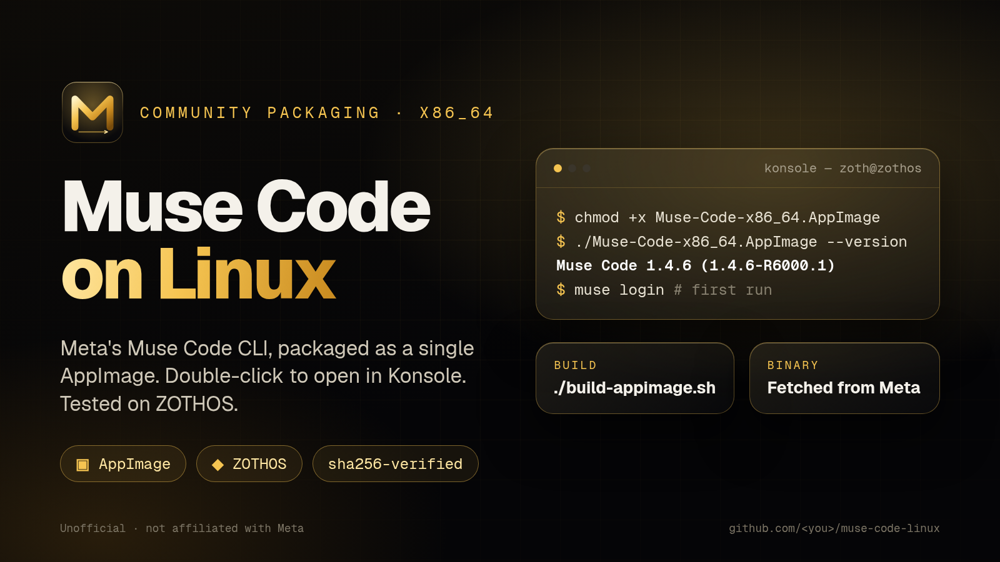

<p align="center"></p>

# Muse Code on Linux (AppImage)

Build a single-file **AppImage** of Meta's official **Muse Code** CLI for x86_64 Linux.
Run it from a terminal, or double-click it and it opens in Konsole (or your system terminal).
Tested on **ZOTHOS** (KDE Plasma).

> **Unofficial community packaging. Not affiliated with, endorsed by, or supported by Meta.**
> This repo contains **no Meta binaries**. `build-appimage.sh` downloads `muse-x86-linux`
> from Meta's own release channel at build time and verifies its sha256 against Meta's
> manifest before packaging it. Don't redistribute the resulting AppImage.

## Quickstart

```bash
git clone https://github.com/<you>/muse-code-linux.git
cd muse-code-linux
./build-appimage.sh                      # needs curl, python3, sha256sum
./Muse-Code-x86_64.AppImage --version    # -> Muse Code 1.4.6 (1.4.6-R6000.1)
./Muse-Code-x86_64.AppImage login        # first run: sign in
```

Optional: put it on your PATH as `muse`:

```bash
mkdir -p ~/Applications ~/.local/bin
mv Muse-Code-x86_64.AppImage ~/Applications/
ln -sf ~/Applications/Muse-Code-x86_64.AppImage ~/.local/bin/muse
```

## How the build works

1. Fetches the channel file `https://api.meta.ai/muse-code/channels/muse-stable`.
2. Reads `manifest_url` and fetches Meta's lookaside manifest.
3. Downloads the `x86_linux` artifact (`muse-x86-linux`) and checks its **sha256** against the manifest. A mismatch aborts the build.
4. Assembles an AppDir (`AppRun`, `.desktop`, icon) and runs `appimagetool` (downloaded automatically if not installed).

Environment overrides: `CHANNEL_URL`, `ARTIFACT`, `WORK`, `OUT`, `APPIMAGETOOL`.

## Signing in

On first use run `muse login`. Meta's launcher notes Muse Code availability may be limited
(e.g. to Meta employees), so your account may be refused even though the download works.
This packaging doesn't change access; it only wraps Meta's binary.

## Notes

- The AppImage doesn't self-update. Re-run `./build-appimage.sh` to pick up a new release.
- CI (`.github/workflows/build.yml`) builds weekly and checks `--version`. It does not publish the AppImage.

## License

The scripts, packaging files and artwork here are MIT (see `LICENSE`).
Muse Code itself is proprietary Meta software under Meta's terms. "Muse" and "Meta" are trademarks of their owners.
